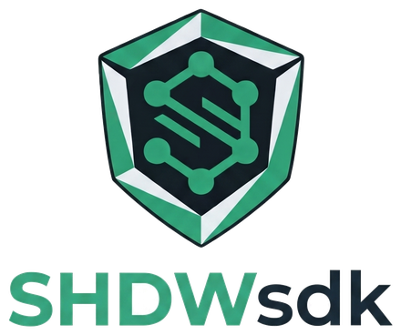

<div align="center">

<a href="https://www.shdwsdk.ai">
  <picture>
    <source media="(prefers-color-scheme: dark)" srcset="https://raw.githubusercontent.com/shdwaibuild/shdwsdk-python/main/.github/assets/logo-dark.png">
    
  </picture>
</a>

### Non-blocking AI carbon telemetry for OpenAI, Anthropic, Gemini and LiteLLM

[](https://pypi.org/project/shdwsdk/)
[](https://pypi.org/project/shdwsdk/)
[](https://github.com/shdwaibuild/shdwsdk-python/actions/workflows/ci.yml)
[](https://github.com/shdwaibuild/shdwsdk-python/blob/main/LICENSE)

[**shdwsdk.ai**](https://www.shdwsdk.ai) · [**Docs**](https://www.shdwsdk.ai/docs/python-otel-litellm) · [**Methodology**](https://www.shdwsdk.ai/docs/scope3-methodology-eu-regions) · [**JavaScript SDK**](https://github.com/shdwaibuild/shdwsdk-js)

</div>

---

This is the open-source Python client for [SHDWsdk](https://www.shdwsdk.ai). It reports **model names and token counts only**: it never sends prompts or completions, and it never raises into your application. SHDWsdk computes energy and carbon server-side with the open [EcoLogits](https://ecologits.ai) methodology and turns your usage into Scope 3 emissions figures, an AI Bill of Materials, and EU AI Act / NIST AI RMF documentation.

The code is public so your security team can check exactly what leaves your app. There are no runtime dependencies (standard library only).

```bash
pip install shdwsdk
export SHDW_API_KEY=shdw_live_...
```

## Instrument a client

```python
import shdwsdk
from openai import OpenAI

shdwsdk.init()                      # reads SHDW_API_KEY; optional grid_region="eu-north-1"
client = shdwsdk.instrument(OpenAI())   # also Anthropic(), AsyncOpenAI(), AsyncAnthropic()

client.chat.completions.create(model="gpt-5.4-mini", messages=[...])
```

## Per-customer Scope 3 statements

Tag calls with **your** customer's account id (pseudonymous, never an email).
SHDWsdk then produces an emissions statement per customer for their supplier reporting.

```python
with shdwsdk.customer(request.account_id):
    client.messages.create(model="claude-sonnet-5-5", ...)
```

`customer()` uses `contextvars`, so it is safe with threads and asyncio.

## LiteLLM

```python
import litellm
from shdwsdk.integrations.litellm import ShdwLiteLLMLogger
litellm.callbacks = [ShdwLiteLLMLogger()]
litellm.completion(model="anthropic/claude-haiku-5-5", messages=[...],
                   metadata={"shdw_customer_ref": "acme-corp"})
```

LiteLLM proxy (`config.yaml`):

```yaml
litellm_settings:
  callbacks: shdwsdk.integrations.litellm.proxy_handler_instance
```

## Short-lived processes

Events are sent from a background thread every 5 seconds and at exit. In serverless functions call `shdwsdk.get_client().flush()` before returning.

## What gets sent

| Sent | Never sent |
|---|---|
| Provider and model ID | Prompts |
| Input / output token counts | Completions |
| Grid region and workload name you configure | API keys for your AI providers |
| Optional customer reference you choose | User emails or personal data |
| Delivery counters: delivered, dropped by reason, retried | |

## Delivery reports

From 0.2.0 the client sends its delivery counters (counts only) with normal batches about once a minute, so the [developer console](https://www.shdwsdk.ai/docs/developer-console) can show drop rates. Turn them off with `ShdwClient(delivery_reports=False)` or `SHDW_DELIVERY_REPORTS=0`.

## Development

```bash
pip install -e ".[test]"
pytest
```

Issues and pull requests are welcome; we check them weekly. For security issues, see [SECURITY.md](https://github.com/shdwaibuild/shdwsdk-python/blob/main/SECURITY.md).

## License

[MIT](https://github.com/shdwaibuild/shdwsdk-python/blob/main/LICENSE)
